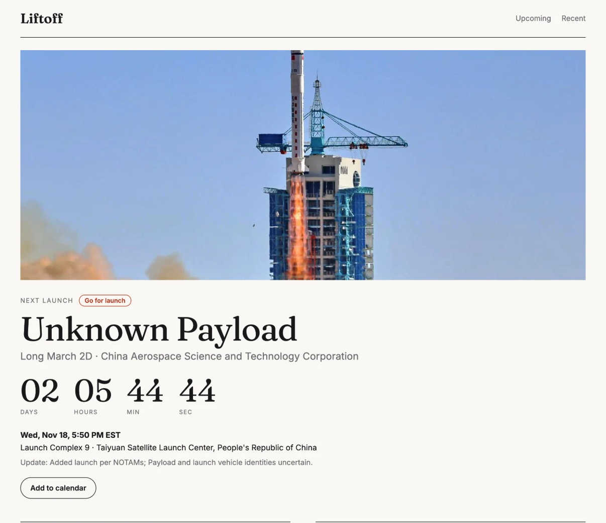

# Liftoff

A worldwide rocket launch tracker. It shows what launches next, where, in what weather, and how to watch it, and it rebuilds itself from public launch data every hour.

**Live site:** https://iknowitsimpossible.github.io/launch-tracker/



## What it does

Liftoff covers launches by every provider worldwide: up to 25 in the next 30 days, plus all launches from the past 30 days with their outcome. Each launch gets its own page:

- **Time:** the launch time in the visitor's own time zone, a live countdown, the latest schedule note from the provider (for example a delay), and a button that downloads an `.ics` calendar event.
- **Pad weather:** the forecast for the hour nearest liftoff, with wind speed and direction, gusts, visibility, cloud cover and chance of rain.
- **Mission:** the destination orbit, whether there's a crew (with names), the payload type, and the booster landing plan (droneship, landing pad or expended), shown as line drawings.
- **Rocket:** the maker, a description, height, liftoff thrust, payload to low Earth orbit, the rocket's success record, and the booster's serial and flight number.
- **Outcome:** for past launches, success, failure or partial failure, with the published reason for a failure.
- **Media:** official livestream links, mission pages, and a launch photo with credit.

The site can be installed to a phone or desktop home screen as a web app.

## When to use it, and its limits

Use it to decide whether a launch is worth watching, to put one in your calendar, or to catch up on the past month. Know these limits:

- **Data is up to about an hour old.** The site rebuilds hourly. A scrub or delay announced minutes before liftoff may not show yet, so check the provider's livestream on launch day.
- **Weather appears only when a forecast is possible:** for launches within 16 days, with an exact launch time, and with known pad coordinates. Otherwise the weather panel says no forecast is available yet, instead of guessing.
- **Uncertain dates are shown as uncertain.** If only the day is known, the page shows the date with no time and the calendar event is all-day. If only a rough date is known, only the month and year are shown.
- **Facts are only as complete as the source.** A missing field (a classified payload's purpose, a booster that isn't tracked) is left blank, never filled in.
- **No flight trajectories.** The public data doesn't include them.
- **Chinese wording can lag by an hour.** New text from the source is translated on the next hourly run. Until then it shows in English on the Chinese pages, marked 原文 (original text).
- **Needs a connection.** The site can be installed but doesn't work offline. The launch facts are in the HTML itself, while local times and countdowns need JavaScript. Without JavaScript, times show in UTC.

## How it works

Liftoff is a static site: there is no server or database, just a data file rebuilt into plain HTML every hour.

```
GitHub Actions (hourly cron, every push to main, or manual run)
  -> scripts/fetch-launches.ts
       Launch Library 2: 2 requests (upcoming + previous, detailed mode)
       Open-Meteo:       1 request covering every eligible launch
       normalize -> validate against src/lib/types.ts -> data/launches.json
  -> scripts/translate.ts (best effort)
       glossary + cache first, Claude API only for new text -> data/translations.zh.json
  -> next build (static export) -> out/
  -> GitHub Pages
```

**Data job** ([scripts/fetch-launches.ts](scripts/fetch-launches.ts)):
- Pools the upcoming and previous lists, removes launches that appear in both, and sorts each launch by its status: one with an outcome counts as recent. The API keeps a launch in "upcoming" for about a day after liftoff, which is why.
- Reshapes each launch into the data shape in [src/lib/types.ts](src/lib/types.ts). Every field is always present, and anything unknown is `null`, never made up. All times are stored in UTC.
- Gets weather for every eligible launch in one batched Open-Meteo request.
- Checks every value against the data shape before writing, so bad API data fails the build instead of reaching the site. The file is written atomically: to a temporary file first, then renamed over the old one.
- Stays within Launch Library's free tier of 15 requests per hour: each run uses 2 and never more than 4, retries included. A network error or server error gets one retry for both APIs.

**Failure handling:** if Launch Library fails on an hourly run, the job stops and the previously published site stays up. Stale data is better than a broken page. If the weather request fails, the site is published without weather. If the fetch fails on a code push, the build falls back to the snapshot committed in `data/launches.json`.

**Chinese version** ([scripts/translate.ts](scripts/translate.ts)): `/zh/` is built from the same `launches.json`, so times, statuses and links match the English pages exactly. Only the wording differs.
- Liftoff's own labels are written in Chinese in the components.
- Text from Launch Library is looked up in three places, in order: [data/glossary.zh.json](data/glossary.zh.json), the reviewed names for rockets, companies and launch sites; then `data/translations.zh.json`, machine translations cached between runs; then the English original, labelled 原文.
- Only text the cache hasn't seen goes to the Claude API, in batches of 30. The glossary is included in every request, so names stay consistent inside sentences too. Mission names and serials stay as published.
- The cache persists between runs in the GitHub Actions cache, not in git, so there are no hourly commits. If translation fails or no API key is set, the site still deploys and the untranslated text shows in English.

**Front end:** Next.js with `output: "export"` pre-renders the home page and one page per launch. Visitor-specific parts run in the browser:
- **Local times** are converted from UTC after the page loads. Before that they show UTC, so the pre-rendered HTML is correct, just not local.
- **Countdowns** on a page all share one one-second timer.
- **Calendar events** (`.ics`) are generated in the browser.

**Sharing and search:** each page has Open Graph and X card tags, so a pasted launch link shows the launch photo, rocket, site and date. English and Chinese pages point at each other with `hreflang` links, and `/sitemap.xml` lists every page in both languages. Missing addresses get a bilingual 404 page that explains launch pages expire 30 days after liftoff.

**Built with:** Next.js 16, React 19, TypeScript, and CSS Modules. Hosted on GitHub Pages. Data from [Launch Library 2](https://thespacedevs.com/llapi) and [Open-Meteo](https://open-meteo.com). Neither of those needs a key. Translation uses the [Claude API](https://platform.claude.com), which reads `ANTHROPIC_API_KEY` from a GitHub Actions secret.

## Running it yourself

Requirements: [Node.js](https://nodejs.org). The deploy workflow uses Node 26, which runs the TypeScript data script directly with no build step.

```bash
git clone https://github.com/Iknowitsimpossible/launch-tracker.git
cd launch-tracker
npm install
```

| Command | What it does |
|---|---|
| `npm run fetch-data` | Downloads fresh launches and weather into `data/launches.json` |
| `npm run dev` | Starts the Next.js development server |
| `node scripts/translate.ts` | Translates new text into `data/translations.zh.json` (needs `ANTHROPIC_API_KEY`; without it, untranslated text stays English) |
| `npm test` | Runs the unit tests (Node's built-in test runner, no extra packages) |
| `npm run build` | Builds the static site into `out/` (also type-checks everything) |
| `npm run lint` | Runs ESLint |

The repo includes a data snapshot, so the site builds without fetching. The production Launch Library API allows 15 requests per hour. When running the data script repeatedly, use the development API by setting `LL_BASE_URL=https://lldev.thespacedevs.com/2.3.0`.

The site's address prefix comes from `NEXT_PUBLIC_BASE_PATH`. The deploy workflow sets it to `/launch-tracker` for GitHub Pages, and it's empty everywhere else. Its full public address comes from `NEXT_PUBLIC_SITE_URL`, used for link previews and the sitemap; the deploy workflow sets it, and elsewhere it defaults to the live site.

Every pull request runs lint, the tests and a full build ([.github/workflows/ci.yml](.github/workflows/ci.yml)), and the deploy workflow runs the tests again before publishing.

## Project structure

- `scripts/fetch-launches.ts`: the data job: fetch, reshape, validate, write.
- `scripts/translate.ts`, `data/glossary.zh.json`: the Chinese translation step and its reviewed names.
- `src/lib/types.ts`: the data shape shared by the data job and the pages.
- `src/app/`: the home page, the per-launch pages (`launch/[slug]/`), and the web app manifest.
- `src/app/global-not-found.tsx`, `src/app/sitemap.ts`: the 404 page and the sitemap.
- `src/components/`: the page sections, including the mission drawings and the rocket figure.
- `tests/`: unit tests for the logic in `src/lib/`. `tests/resolve-ts.mjs` lets Node load the app's TypeScript imports as Next writes them.
- `.github/workflows/deploy.yml`: the hourly fetch, test, build and deploy.
- `.github/workflows/ci.yml`: the checks every pull request runs.
